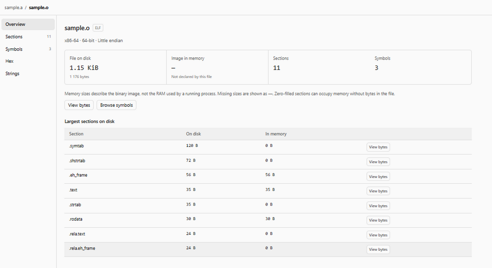

# Binary & Assembly Tools

Binary inspection and Assembly highlighting for Orca, using the current Orca theme.



Binary files open directly inside Orca's editor tabs. No website, local server, or external application is required.

## Open an inspection

Choose **New binary inspection** from the tab bar **+** menu, the command palette, or the plugin's **Create** action. The empty inspection offers **Try ELF object** and **Try static archive** demonstrations. You can also open a supported file in the editor, use **Open file…**, or drop a local file into the inspector.

The syntax contribution's **Try** action in Orca creates an empty source file. For filled source examples use **New Intel assembly example**, **New AT&T assembly example**, or **New ARM assembly example**. These templates open in the normal Orca text editor.

## Binary inspection

- **Overview** summarizes format, architecture, file size and the image size declared by load headers. **Sections** lists file and memory sizes separately.
- **Symbols** searches and sorts available ELF, COFF and PE names, addresses, bindings, visibility and declared sizes. Function/data/import/export filters select metadata actually present in the file. Names remain as recorded, including C++ mangled names; no external tools run.
- **Archive objects** lists AR members, including GNU and BSD long names. Inspect a member, then use the archive breadcrumb to return to its previous table state. Index and name-table members are marked as metadata.
- **Hex** shows synchronized bytes and ASCII, an optional data inspector, explicit hex/text search and decimal or `0x` offset navigation. Hex queries accept both `7F454C46` and `7F 45 4C 46`. Arrow keys move the selected byte when the byte view is focused. Search shows up to 100,000 matches with an explicit limit notice; narrow the query if this limit is reached.
- **Strings** extracts UTF-8 strings of at least four characters. Filtering and cursor-based page scans keep every extracted string accessible without retaining the whole result set. Very long strings have a marked 4,096-character preview; **View bytes** opens the complete range.

Supported structural analysis: ELF32/ELF64, little/big endian, ELF symbol tables and load headers; PE32/PE32+ sections/imports/exports; ordinary COFF objects; GNU/BSD AR archives. Mach-O and unknown formats remain available as hex and strings. Thin archives cannot inspect external members. Unsupported metadata variants produce a notice while preserving the byte view.

File sizes are limited to **64 MiB**, matching Orca's document bridge limit. Larger local files are rejected rather than silently truncated. Search and string extraction yield between chunks and cancel when the inspected document changes.

Memory sizes describe headers and sections, **not process RAM usage**. Relocatable object files and archives have no declared loaded image size. Missing symbol sizes are shown as **—**, not estimated from neighboring addresses; zero-filled sections have no file bytes to jump to. Stripped files can have no symbols. PE imports/exports often provide names without sizes. Raw section and symbol values remain distinguishable from mapped file offsets.

The inspector only reads bytes. It does not edit or execute the inspected program. Opening a local file or a demo changes the inspection view, not the contents of the Orca document behind it.

## Assembly syntax

- x86/x86-64 Intel and AT&T: `.asm`, `.inc`.
- ARM/AArch64: `.arm`, `.a64`.
- GNU Assembly: `.s`, including numeric ARM immediates such as `#1` and GNU preprocessor directives. GAS accepts several architectures; this generic grammar does not infer the target CPU.

## Validation

Run the parser and search regression suite with:

```sh
node --test tests/binary-core.test.mjs
```

UI acceptance includes archive/member/back navigation, replacement during search, empty files, malformed headers, explicit hex/text queries, keyboard navigation, both Orca theme modes and narrow panels.

## License

MIT
