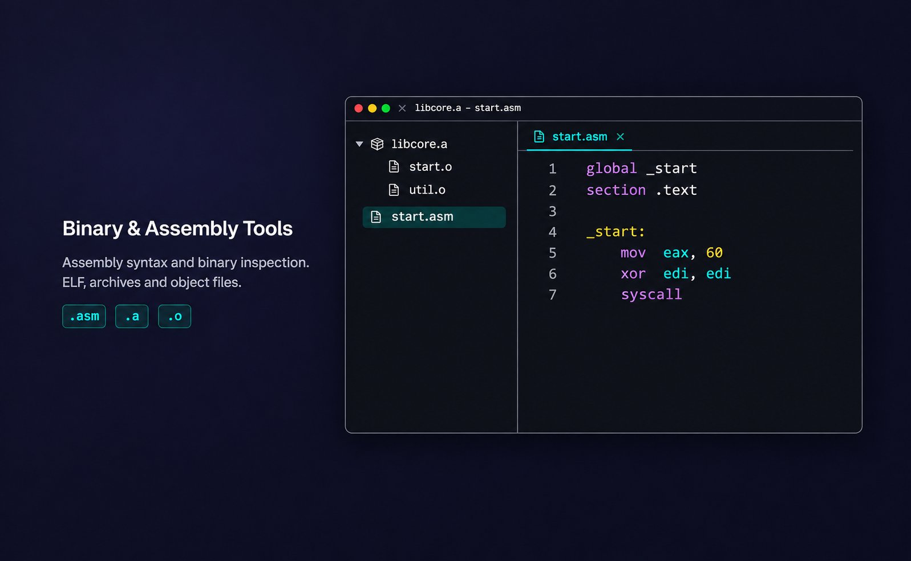

# Binary & Assembly Tools

Binary inspection and Assembly highlighting for Orca, using the current Orca theme.



Binary files open directly inside Orca's editor tabs. No website, local server, or external application is required.

## Install

In **Settings → Plugins → Add plugin**, choose **From a Git URL…** and enter `https://github.com/be0hhh/orca-binary-tools#v1.1.4`, or choose **From a folder…** for a downloaded and extracted release. Confirm the installation and enable the plugin.

Use a normal installation for everyday inspection. **Development folders** enable live reload while editing plugin files; watcher retries can also reload an open inspector. Remove this plugin's development-folder entries before switching to a normal installation.

## Open an inspection

Choose **New binary inspection** from the tab bar **+** menu, the command palette, or the plugin's **Create** action. Open an existing supported binary through Orca’s file editor, or use the single **Open file** action in an empty inspection to choose a file with any name or extension. A file opened from Orca loads automatically; there is no Analyze or Load step.

The plugin works with Orca **1.4.245 or newer**, without changes to Orca itself. Extensionless files, unknown extensions and versioned libraries such as `libexample.so.1` can be selected with **Open file**.

A file selected through **Open file** is a read-only snapshot; its name appears beside the format. Selection does not change or save the document behind the Orca tab, and rebuilding the selected file does not refresh that snapshot automatically. Open another empty inspection to select it again. A later replacement of the tab's own document returns the inspector to that document. The picker selects files available on the client machine (including accessible Windows/WSL shares), rather than browsing an SSH host.

The syntax contribution's **Try** action in Orca creates an empty source file. For filled source examples use **New Intel assembly example**, **New AT&T assembly example**, or **New ARM assembly example**. These templates open in the normal Orca text editor.

## Binary inspection

- A single metadata line shows format, architecture, file size and any image size declared by load headers. **Sections** lists file and memory sizes separately. Archive files open directly to their members; ELF/PE/COFF files open to available symbols, otherwise sections or hex. Unavailable sections of the navigation are hidden.
- Table pages reuse the prepared sort and filter. File offsets and archive names are direct links; there is no repeated action button on every row. Compatible document updates preserve the chosen view, filter and position.
- **Symbols** searches and sorts available ELF, COFF and PE names, addresses, bindings, visibility and declared sizes. Function/data/import/export filters select metadata actually present in the file. Names remain as recorded, including C++ mangled names; no external tools run.
- **Archive objects** lists AR members, including GNU and BSD long names. Inspect a member, then use the archive breadcrumb to return to its previous table state. Index and name-table members are marked as metadata.
- **Hex** shows synchronized bytes and ASCII, an optional data inspector, explicit hex/text search and decimal or `0x` offset navigation. Press Enter in the byte-search field to search. Hex queries accept both `7F454C46` and `7F 45 4C 46`. Arrow keys move the selected byte when the byte view is focused; Home/End move within a row and Ctrl/Cmd+Home/End move to the first/last file byte. The accessible byte grid exposes file offsets, hex/decimal values and selection for screen readers and computer-use agents. Search shows up to 100,000 matches with an explicit limit notice; narrow the query if this limit is reached.
- **Strings** extracts UTF-8 strings of at least four characters. Filtering and cursor-based page scans keep every extracted string accessible without retaining the whole result set. Very long strings have a marked 4,096-character preview; clicking the file offset opens the complete range in Hex.

Supported structural analysis: ELF32/ELF64, little/big endian, ELF symbol tables and load headers; PE32/PE32+ sections/imports/exports; ordinary COFF objects; GNU/BSD AR archives. Mach-O and unknown formats remain available as hex and strings. Thin archives cannot inspect external members. Unsupported metadata variants produce a notice while preserving the byte view.

File sizes are limited to **64 MiB**, matching Orca's document bridge limit. Larger documents are rejected rather than silently truncated. Search and string extraction yield between chunks and cancel when the inspected document changes.

Memory sizes describe headers and sections, **not process RAM usage**. Relocatable object files and archives have no declared loaded image size. Missing symbol sizes are shown as **—**, not estimated from neighboring addresses; zero-filled sections have no file bytes to jump to. Stripped files can have no symbols. PE imports/exports often provide names without sizes. Raw section and symbol values remain distinguishable from mapped file offsets.

The inspector only reads bytes. It does not edit or execute the inspected program.

## Appearance

The binary tables, hex/ASCII view, strings and inspector share a code-editor font stack and full-size text: Fira Code with Cascadia Mono/Consolas fallbacks, 14 px regular type and 19 px line spacing. These match the editor preferences used for this release; Orca's current frame API exposes theme colors but does not expose the user's live editor font settings. Changing Orca's font later does not automatically update this plugin. No font files are bundled.

Hex row geometry follows its computed line height, and columns use character-relative widths. Narrow views scroll rather than shrinking the data text. Theme colors continue to update through Orca's frame tokens.

## Assembly syntax

- x86/x86-64 Intel and AT&T: `.asm`, `.inc`.
- ARM/AArch64: `.arm`, `.a64`.
- GNU Assembly: `.s`, including numeric ARM immediates such as `#1` and GNU preprocessor directives. GAS accepts several architectures; this generic grammar does not infer the target CPU.

## Validation

Run the parser and search regression suite with:

```sh
npm ci --ignore-scripts
npm test
```

The parser/search suite is accompanied by DOM tests that execute the actual UI module with a mocked Orca document session. They check default panes, empty state, archive/member/back state, document replacement, search and the absence of duplicate application chrome. Native acceptance also checks both Orca theme modes, narrow panels and keyboard navigation.

## License

MIT
